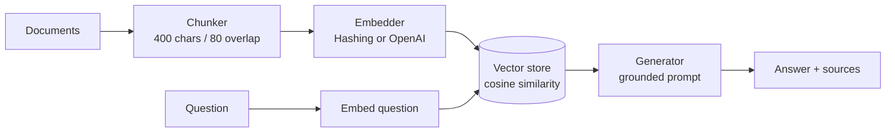

# raglite

[](https://github.com/busnis887-design/raglite/actions/workflows/tests.yml)  [](LICENSE)

A small, testable **Retrieval-Augmented Generation (RAG)** pipeline in Python. It keeps the whole `ingest → embed → retrieve → generate` loop transparent and runs offline with zero third-party dependencies, while exposing plug-in points for real embedding and chat models.

## Why this exists

Most RAG tutorials hide the important parts behind a framework. `raglite` makes each stage explicit and swappable:

| Stage | Default | Swap with |
| --- | --- | --- |
| Chunking | sentence-aware, overlapping | any `list[Chunk]` producer |
| Embeddings | deterministic hashing embedder | `OpenAIEmbedder` / your own |
| Storage | in-memory cosine search | FAISS, Qdrant, pgvector |
| Generation | grounded extractive answers | `OpenAILLM` / your own |

## Quickstart

```bash
python -m raglite.cli demo
```

```
Indexed 2 chunks from .../examples/docs
Timeouts are set to 30 seconds and failed calls follow an exponential backoff retry policy with three attempts.

Sources: api-guide.txt, architecture.txt
```

Index your own documents and ask questions:

```bash
python -m raglite.cli ingest ./docs --pattern "*.txt"
python -m raglite.cli ask "How does the retry policy work?" --top-k 3
```

## Library usage

```python
from raglite import RAGPipeline, OpenAIEmbedder, OpenAILLM

pipeline = RAGPipeline(
    embedder=OpenAIEmbedder(),          # optional; HashingEmbedder by default
    llm=OpenAILLM(),                    # optional; ExtractiveLLM by default
    chunk_size=400,
    overlap=80,
)
pipeline.ingest_files("./docs")

answer = pipeline.ask("What is the retry policy?")
print(answer.answer)
print(answer.sources)
```

## Architecture



## Design decisions

- **Grounding by default.** The extractive generator only copies sentences from retrieved chunks and refuses to answer when retrieval returns nothing (`NO_CONTEXT`).
- **No hidden network calls.** The default pipeline is fully deterministic and works in CI without API keys.
- **Protocol-based adapters.** `Embedder` and `LLM` are structural protocols, so any object with the right method shape can be injected.
- **Small surface area.** ~350 lines of core code; easy to audit and extend.

## Tests

```bash
python -m unittest discover -s tests -v
```

Covers chunk overlap/coverage, deterministic embeddings, cosine ranking, grounded answers, the no-context path, and validation errors.

## Roadmap

- Persistent vector index (SQLite / numpy)
- Hybrid BM25 + dense retrieval
- Answer citation spans and faithfulness scoring
- Streaming generation

## License

MIT
